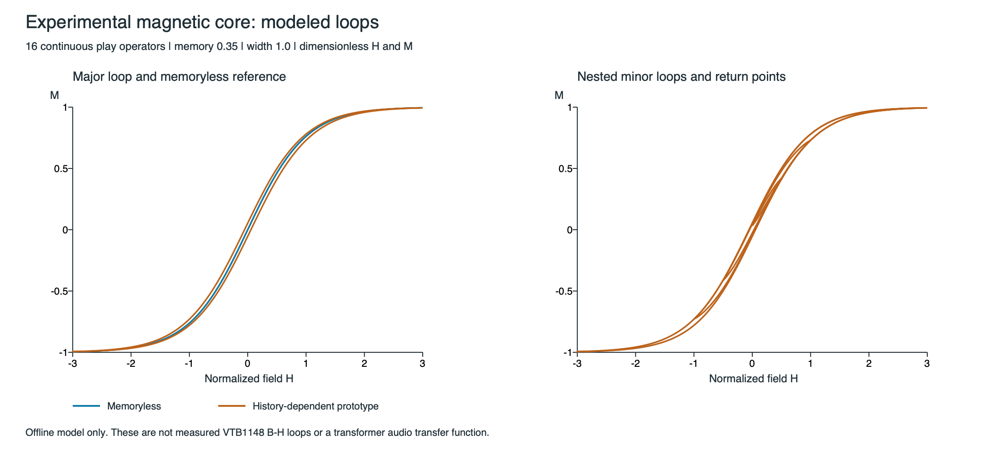

# Magnetic core experiment — step 1

Follow-up: [filtered oversampling comparison](MagneticOversamplingComparison.md)
tests 2x/4x/8x/16x candidates against 32x/64x offline references, retaining this
original core and live-plugin isolation.

This is an **offline constitutive-law prototype**, linked only into `Tests`.
The live transformer, compressor, parameter/state format, generic editor,
measurement panel and saved tanh favorite are unchanged. There is no model
selector or magnetic control in the plugin yet.

## Model and scope

`source/experimental/PlayPreisachCore` maps normalized magnetic field H to
normalized magnetization M. It implements a discrete generalized Preisach form
using 16 continuous play operators and positive normalized weights:

```
p[i] = clamp(p[i], H - r[i], H + r[i])
M = (1 - memory) * tanh(H / a)
    + memory * sum(w[i] * tanh(p[i] / a))
```

Each play state retains a reversal history; the smooth density bounds each
contribution. The reversible term and weighted history term form a convex
combination, so |M| <= 1. The default `memory` is 0.35 and `width` is 1.0.
Log-spaced radii, their density, saturation scale, ranges and safety field limit
are centralized in `source/experimental/MagneticCoreSettings.h`. These are
heuristic engineering values, not identified material properties.

The play-coordinate formulation is described in Massi et al.,
[Section 3.1, equations 20–26](https://link.springer.com/article/10.1186/s13636-023-00277-8).
This experiment uses a chosen monotone density; it does not implement that
paper's trained RNN. Schipper et al.'s
[transformer Preisach study](https://arxiv.org/html/2503.22129v1) provides a
separate example of identification from actual transformer measurements.

Silence preserves remanent M. `reset()` explicitly returns the model to its
demagnetized initial state. `prepare()` bounds the two engineering settings,
prepares weights/radii, and resets history. Changing settings requires a new
prepare; there is no unsmoothed live-parameter path. Nonfinite input holds the
last valid state/output; finite H is limited to +/-32 before arithmetic.

The core has no sample-rate argument: it is rate-independent on each monotone
field segment. Sampled inputs can miss extrema, so this does not imply identical
high-frequency sampled output at different rates.

M is **not audio output voltage**. This experiment includes no voltage/flux
integration, winding/source/load circuit, eddy-current losses, electrical
calibration or VTB1148 fitting. Remanence in M is not a reason to send its DC
level into the audio path. Tanh remains a bounded density here; play state
supplies the new hysteresis behavior.



## Verification and reproducible reports

The Catch2 cases cover normalized weights, finite bounded output, invalid and
extreme inputs, independent instances, deterministic reset, remanence, odd
symmetry under mirrored histories, monotone continuous branches, positive loop
work, nested return-point closure, wiping-out and common-time agreement at
44.1/48/96/192 kHz. The one-Hz triangular field includes its turning points at
all four rates. Existing audio-reference and plugin regressions still apply.

The process method has fixed storage (408 bytes in the current arm64 build),
16 play updates and 17 tanh evaluations per field sample. There are no heap
allocations, locks, logging, adaptive iterations or JUCE/UI calls in the core.
This is an operation/storage bound, not a portable timing guarantee.

Use the usual configure/build workflow, including all three plugin targets and
Tests, then run:

```bash
LUMIERE_MAGNETIC_REPORT_DIR=/private/tmp/lumiere-magnetic-v1 ./Builds/Debug/Tests '[magnetic],[magnetic-report]' --reporter compact
```

The exported files are:

- `loops.csv`: major, nested and memoryless **modeled H/M** paths.
- `sampling.csv`: 48 cases at four rates, four tone regions and three normalized
  field amplitudes (0.05, 1, 4). These amplitudes are not dBFS or dBu.
- `cost.csv`: local Debug median of five runs of 32,768 mono samples, including
  loop/checksum overhead. It is a smoke measurement, not the Benchmarks target.

The checked-in [report files](measurements/magnetic_core_v1/) record this run.
`tools/render_magnetic_core_report.py <report-directory>` uses ReportLab to
produce an SVG plot from the loop CSV. This is a separate offline plotting tool.

## Sampling/aliasing method

A coherent 16,384-sample window uses the nearest odd carrier bin to each nominal
50/1000/7000/10000 Hz tone. Actual frequencies are recorded. One full window is
discarded to establish periodic history. The core is also evaluated on 4x and
8x denser offline grids over the same duration; these references do not add
oversampling to the plugin.

Normalized complex FFT bins form the comparison. The 8x reference is restricted
to frequencies below base Nyquist. `nonharmonic_alias_dbr` sums base-rate power
outside the DC/carrier's integer-multiple bins, relative to reference in-band
RMS power. An odd carrier avoids low-order fold collisions with genuine harmonic
bins. `inband_residual_dbr` additionally captures differences at genuine harmonic
bins, including missed-extremum/history discretization effects. It is not a
pure aliasing measurement. `reference_4v8_dbr` checks reference convergence;
the 8x result is an approximation, not an alias-free analytical ground truth.
Float FFT precision limits very low reported errors.

The continuous play response still has slope changes at reversals/thresholds.
No ADAA or antialiasing is claimed for this stateful model. The existing tanh
stage's residual ADAA cannot simply be applied to a history-dependent operator.
The results show substantial high-frequency aliasing under stronger drive. A
future live candidate needs a defined antialiasing strategy and CPU evaluation
before listening integration. This step establishes the offline model and
measures its limitations; it does not establish a calibrated VTB1148 emulation.
