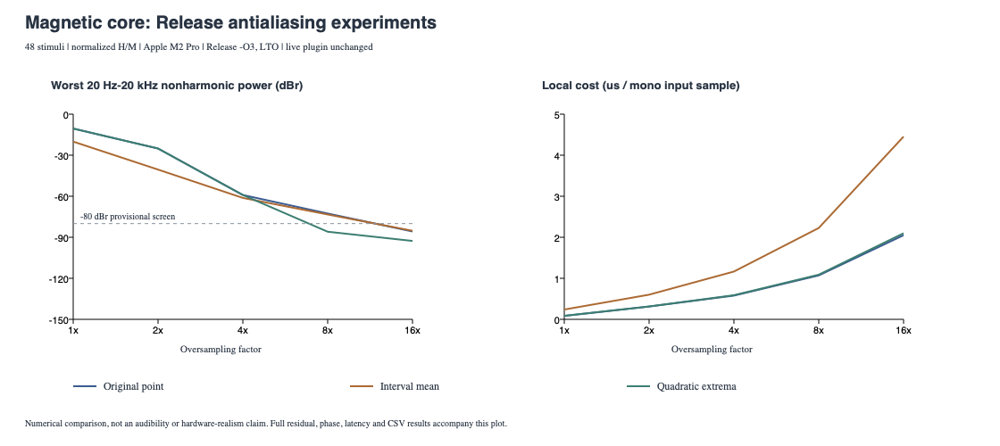

# Magnetic antialiasing follow-up: Release

Normalized H-to-M research, Apple M2 Pro / arm64 / Release (-O3, LTO). Live plugin, tanh favorite, parameters, UI and latency unchanged.

## Results

The cheapest tested all-grid screen pass in this run is **Quadratic extrema at 8x**. This is a research result, not a live-plugin selection.

| Method | Factor | Worst 20 Hz–20 kHz dBr | Cases <= -80 | Worst passband residual dBr | Max abs fundamental gain error | Max abs phase error | Median local ns/mono sample | Latency at 48 kHz |
|---|---:|---:|---:|---:|---:|---:|---:|---:|
| Original point | 1x | -10.51 | 21/48 | -10.63 | 0.085519 dB | 0.549336 deg | 83.6 | 0.0000 ms |
| Original point | 2x | -25.11 | 28/48 | -31.94 | 0.019727 dB | 0.179049 deg | 312.1 | 2.0625 ms |
| Original point | 4x | -59.08 | 34/48 | -56.66 | 0.004514 dB | 0.047807 deg | 578.5 | 2.5729 ms |
| Original point | 8x | -72.62 | 42/48 | -69.39 | 0.001138 dB | 0.011925 deg | 1070.3 | 2.8281 ms |
| Original point | 16x | -85.76 | 48/48 | -82.11 | 0.000306 dB | 0.002969 deg | 2050.5 | 2.9557 ms |
| Interval mean | 1x | -20.05 | 23/48 | -12.00 | 2.510446 dB | 0.623724 deg | 238.7 | 0.0104 ms |
| Interval mean | 2x | -40.50 | 30/48 | -23.71 | 0.585555 dB | 0.130868 deg | 601.2 | 2.0677 ms |
| Interval mean | 4x | -61.22 | 38/48 | -35.64 | 0.144556 dB | 0.031455 deg | 1165.0 | 2.5755 ms |
| Interval mean | 8x | -73.33 | 43/48 | -47.65 | 0.036037 dB | 0.007806 deg | 2226.5 | 2.8294 ms |
| Interval mean | 16x | -85.25 | 48/48 | -59.66 | 0.009022 dB | 0.001961 deg | 4453.6 | 2.9564 ms |
| Quadratic extrema | 1x | -10.51 | 24/48 | -10.63 | 0.068383 dB | 0.317701 deg | 86.7 | 0.0000 ms |
| Quadratic extrema | 2x | -25.11 | 32/48 | -31.94 | 0.010538 dB | 0.029414 deg | 313.7 | 2.0625 ms |
| Quadratic extrema | 4x | -59.09 | 38/48 | -59.09 | 0.001301 dB | 0.001802 deg | 588.3 | 2.5729 ms |
| Quadratic extrema | 8x | -85.94 | 48/48 | -85.51 | 0.000170 dB | 0.000069 deg | 1088.1 | 2.8281 ms |
| Quadratic extrema | 16x | -92.67 | 48/48 | -92.52 | 0.000043 dB | 0.000085 deg | 2098.5 | 2.9557 ms |

The -80 dBr screen integrates nonharmonic power over 20 Hz–20 kHz, relative to high-rate reference RMS below base Nyquist. It is not an audibility standard; genuine-harmonic overlap is excluded by this metric, and very low values approach float FFT precision. Full-band aliases, residuals and reference checks remain in each CSV.

## Interpretation

- Original 16x measured 2.050 us per mono input sample. It remains the unchanged numerical baseline.
- Interval 8x measured 1.09 times the original 16x cost and passed 43/48 cases. Averaging's treble loss remains in the gain/residual results; no compensation was used.
- Quadratic-extrema 8x passed 48/48 cases; its worst band result was -85.94 dBr. Its cost was 0.53 times original 16x.
- Worst passband complex residual: -85.51 dBr at quadratic-extrema 8x versus -82.11 dBr at original 16x. This includes DC/harmonic error, filter response and history differences, rather than only nonharmonic bins.
- Turning-point reconstruction estimates missed extrema with a local parabola. It changes sampled history and is not exact for arbitrary audio. Improvements on coherent tones need multitone/transient validation before any integration.
- Interval integration preserves endpoint history but cannot restore unsampled reversals. It tests averaging separately from reversal reconstruction.
- Summary timings above use the median of three matched-binary sweeps, each itself a median of five x 32768 mono base samples, H peak 4, repeated 256-sample sine. They include filtering/core/copy/checksum, exclude prepare/FFT, and do not establish host deadline safety or workload-independent speed. Factor order alternates and method order rotates across sweeps.

## Matched-binary cost stress checks

The profiling.csv export was run sequentially after builds/tests, with no other experiment running. The per-method cost.csv files retain the initial grid-export timings; the table/plot use profiling.csv. Values below are ns per mono input sample, median across the three sweeps.

| Stimulus | Original 8x | Original 16x | Interval 8x | Quadratic extrema 8x | Cost saving vs original 16x |
|---|---:|---:|---:|---:|---:|
| H peak 4, slow sine (187.5 Hz at 48k) | 1070.3 | 2050.5 | 2226.5 | 1088.1 | 46.9% |
| H peak 0.05, fast sine (9937.5 Hz at 48k) | 762.3 | 1410.6 | 806.8 | 804.3 | 43.0% |
| H peak 4, seeded repeating noise | 1107.5 | 2150.7 | 2233.7 | 1197.1 | 44.3% |

## The six original 8x failures

Values below use the same 8x filters. Normalized H peak is not audio dBFS.

| Base rate | Actual tone | H peak | Original dBr | Interval dBr | Quadratic extrema dBr |
|---:|---:|---:|---:|---:|---:|
| 44100 | 7000.98 | 0.05 | -77.12 | -79.26 | -86.04 |
| 44100 | 9999.48 | 0.05 | -72.62 | -73.33 | -85.94 |
| 44100 | 9999.48 | 1 | -78.67 | -77.99 | -87.27 |
| 48000 | 6999.02 | 0.05 | -79.85 | -80.72 | -93.23 |
| 48000 | 9999.02 | 0.05 | -73.63 | -74.67 | -87.22 |
| 48000 | 9999.02 | 1 | -77.98 | -79.18 | -88.52 |

## Calibration and limits

Worst final analytic-reference convergence disagreement: -100.54 dBr. References remain 32x/64x with adaptive 128x as in the original experiment.

- Original point: maximum absolute identity gain error over the measured 20 Hz–20 kHz probes: 0.000042 dB.
- Interval mean: maximum absolute identity gain error over the measured 20 Hz–20 kHz probes: 16.741593 dB. Includes its expected two-tap response across all factors, including 1x.
- Quadratic extrema: maximum absolute identity gain error over the measured 20 Hz–20 kHz probes: 0.000042 dB.

At elevated sample rates, ultrasonic transition-band aliases can dominate full-band totals; the screen above does not include those frequencies. Magnetic constitutive behavior alone is not a transformer voltage model or a hardware fit.

[Method, derivation, limitations and reproduction](../../MagneticAntialiasingFollowup.md). Raw exports are in point/, interval/ and turning/. The original Debug report is preserved in ../magnetic_oversampling_v1/.
