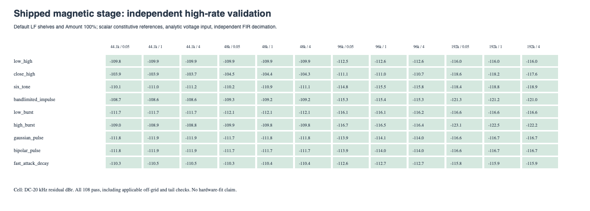
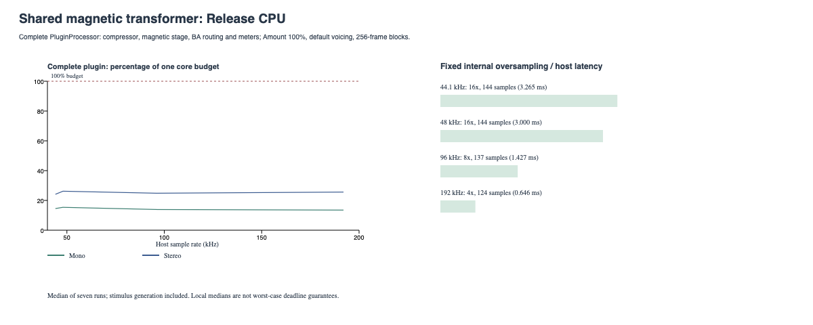

# Shared magnetic transformer v2

The old tanh/residual-ADAA audio stage is removed from VST3, AU, Standalone and active offline measurements. The internal magnetic constitutive tanh remains; its hot evaluation uses a preparation-built polynomial table. Legacy voicing JSON migrates numeric controls, without restoring the old audio engine.

**108/108 shipped-stage screens pass, with zero solver failures.** These use default LF emphasis and Amount 100% (+12 dB drive), and compare actual float stage output with analytically driven, scalar-constitutive high-rate references.

Worst DC-20 kHz residual: **-103.73 dBr**. Worst reference convergence residual: **-105.19 dBr**. Maximum shipped-stage solver iterations: **4**. The scaled target remains 1e-13.

## Complete-plugin Release CPU

| Rate Hz | Channels | Factor | Host latency | One-core audio budget % |
|---:|---:|---:|---:|---:|
| 44100 | 1 | 16x | 144 | 14.5 |
| 44100 | 2 | 16x | 144 | 24.1 |
| 48000 | 1 | 16x | 144 | 15.4 |
| 48000 | 2 | 16x | 144 | 26.2 |
| 96000 | 1 | 8x | 137 | 13.9 |
| 96000 | 2 | 8x | 137 | 24.8 |
| 192000 | 1 | 4x | 124 | 13.5 |
| 192000 | 2 | 4x | 124 | 25.6 |

Seven 16,384-frame runs, median, after prepare; block size 256; low-tone input at 60/73 Hz. Includes stimulus generation, full processor, compressor, magnetic stage, BA routing and meter publication. Preparation and file output are excluded. Profiling runs do not overlap builds or tests. This is a local signal-specific measurement, not a worst-case guarantee. Release is the listening build; Debug retains debugging overhead.

## Listening

Three synthetic stereo fixtures, six seconds, 48 kHz float32: bass phrase, percussion and low/high tones. Each has source, raw and linked whole-file RMS-matched linear-core, magnetic-core and shared live-magnetic renders. The raw core uses drive 0 dB without LF shelves; the live stage uses Amount 100% (+12 dB drive) and default 12 dB / 120 Hz shelves. These settings differ deliberately; this is not an isolated hysteresis A/B. FIR delay is removed, magnetic phase remains, and no limiting or DC subtraction is applied. RMS matching is an audition aid, not perceptual loudness matching.

| Synthetic fixture | Source | Linear core matched | Magnetic core matched | Live magnetic matched |
|---|---|---|---|---|
| synthetic_bass | [WAV](synthetic_bass_source.wav) | [WAV](synthetic_bass_linear_matched.wav) | [WAV](synthetic_bass_magnetic16_matched.wav) | [WAV](synthetic_bass_live_magnetic_matched.wav) |
| synthetic_percussion | [WAV](synthetic_percussion_source.wav) | [WAV](synthetic_percussion_linear_matched.wav) | [WAV](synthetic_percussion_magnetic16_matched.wav) | [WAV](synthetic_percussion_live_magnetic_matched.wav) |
| synthetic_low_high | [WAV](synthetic_low_high_source.wav) | [WAV](synthetic_low_high_linear_matched.wav) | [WAV](synthetic_low_high_magnetic16_matched.wav) | [WAV](synthetic_low_high_live_magnetic_matched.wav) |

The archived tanh recordings/preference remain historical evidence only. No current renderer executes that audio model.

## Limits and data

This is a normalized, uncalibrated voltage-driven magnetic circuit, not a VTB1148 fit. The simplified model omits winding capacitance, leakage and eddy-current dynamics. The tested grid covers nine waveforms, four rates and input peak bounds 0.05/1/4; it does not certify arbitrary inputs or every voicing. Core voltage safety limits and the saturated-field extension remain explicit numerical definitions.

The 108 previous extreme-parameter trajectories now converge at the unchanged 1e-13 target, with a carried-slope predictor and bounded 96-evaluation fallback. The degree-five constitutive lookup is tested at two million points against the scalar function; maximum observed value error is at most 2e-15. Model equations are unchanged by that numerical acceleration.

The separate extended probe passes all 432 trajectories with zero failures and a maximum of 61 evaluations, including combined drive/calibration extremes and instantaneous reversals. [Probe results](solver_extremes.csv). Debug and Release each pass 129 functional tests / 282,010 assertions. VST3, AU, Standalone and Tests build cleanly in both configurations; Benchmarks was not built.

[Implementation and reproduction](../../MagneticTransformerLive.md). [Shipped-stage grid](live_validation.csv), [plugin CPU](plugin_cpu.csv), [raw-core supplementary comparisons](comparison.csv), [raw-core convergence](convergence.csv), [tone measurements](tones.csv), [listening gains](listening.csv), [provenance](manifest.json).
