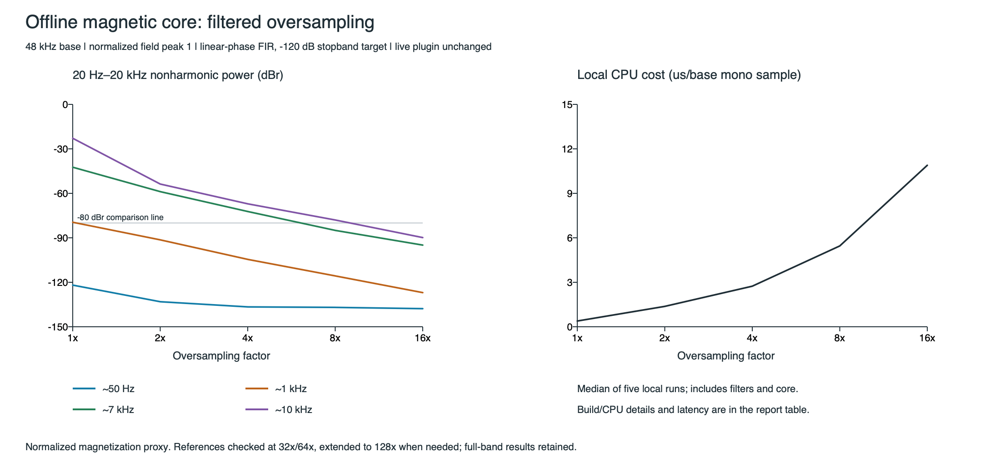

# Offline magnetic oversampling comparison v1

Same core: `preisach-play-core-v1`, memory 0.35 / width 1.0. All results describe normalized H/M, not transformer audio or measured VTB1148 hardware.

## Results

The lowest tested factor meeting the provisional -80 dBr nonharmonic screen over **20 Hz–20 kHz** in all 48 cases is **16x**.

The -80 dBr screen is a comparison goal, not an audibility standard. Fundamental/harmonic accuracy and reference uncertainty must also be considered. No live plugin setting has changed.

| Factor | Worst full-band dBr | Worst 20 Hz–20 kHz dBr | Median 20 Hz–20 kHz dBr | Band cases <= -80 dBr | Local ns/base mono sample | Latency at 48 kHz |
|---:|---:|---:|---:|---:|---:|---:|
| 1x | -10.50 | -10.51 | -74.29 | 21/48 | 387.7 | 0.000 ms |
| 2x | -25.03 | -25.11 | -89.43 | 28/48 | 1375.6 | 2.062 ms |
| 4x | -41.66 | -59.08 | -108.52 | 34/48 | 2737.4 | 2.573 ms |
| 8x | -41.66 | -72.62 | -126.16 | 42/48 | 5452.3 | 2.828 ms |
| 16x | -41.66 | -85.76 | -135.03 | 48/48 | 10892.0 | 2.956 ms |

The cost column includes FIR interpolation, all core updates, FIR decimation, input copies and a checksum. Preparation and FFT are excluded. Timings are local build measurements, not realtime deadline guarantees.

Apple M2 Pro; Debug; median 5 x 32768 mono base samples; includes filters/core/copy/checksum, excludes prepare/FFT.

16x measured 28.1 times the 1x cost in this run. A factor that meets the numerical screen is not automatically a practical production setting.

## Aliases at 48 kHz, normalized field peak 1

Values integrate nonharmonic power over 20 Hz–20 kHz, relative to the final reference's full in-band RMS magnetization. Nominal tone labels below are snapped to coherent frequencies recorded in the CSV.

| Factor | ~50 Hz | ~1 kHz | ~7 kHz | ~10 kHz |
|---:|---:|---:|---:|---:|
| 1x | -121.89 | -79.50 | -42.38 | -22.86 |
| 2x | -133.10 | -91.37 | -58.84 | -53.72 |
| 4x | -136.59 | -104.54 | -72.25 | -67.07 |
| 8x | -136.92 | -115.69 | -84.99 | -77.98 |
| 16x | -137.78 | -126.96 | -94.91 | -89.84 |

## Calibration and interpretation

- Worst initial 32x/64x reference disagreement: -94.13 dBr. 3 stimuli required a 64x/128x check; worst final disagreement: -100.54 dBr. The reference is approximate and very low errors are FFT-precision limited.
- Maximum absolute identity round-trip gain error over the measured 20 Hz–20 kHz probes: 0.000042 dB.
- Maximum identity phase error after removing reported FIR latency: 0.000000 degrees.
- Full and passband residuals also include filter response and history/extremum sampling differences. They are not pure alias measurements.
- Remaining aliases can overlap genuine harmonics; the nonharmonic-bin metric alone cannot certify an alias-free result.
- The 16x worst full-band value is -41.66 dBr at base rate 96000 Hz, nominal tone 7000 Hz and field peak 4. Its strongest nonharmonic component is at 46986.33 Hz. Both full-band and 20 Hz–20 kHz results are retained.
- Nonharmonic artifacts can include sidebands from sampled turning-point history as well as folded harmonics.
- Release profiling, voltage/flux/circuit coupling, and richer stimuli remain necessary before any production choice.

[Method, tests and reproduction commands](../../MagneticOversamplingComparison.md).
