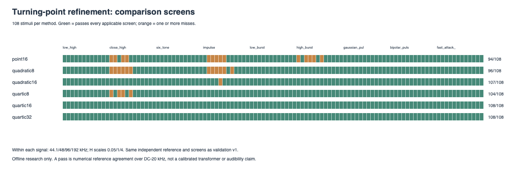
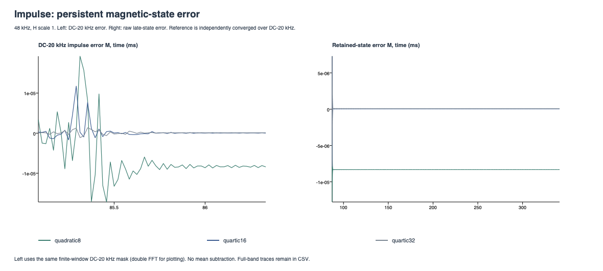
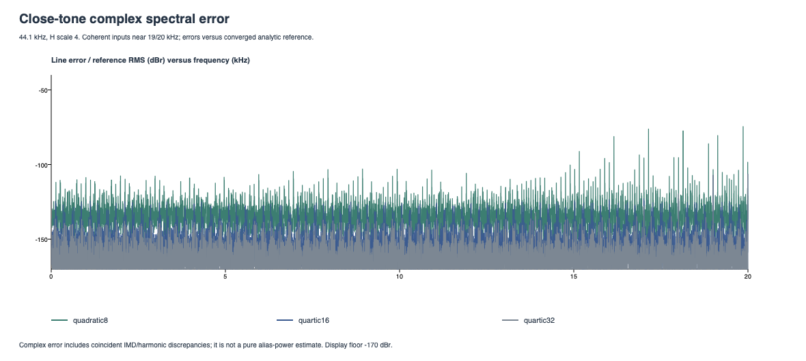

# Magnetic artifact refinement

Offline H-to-M numerical research only. Live audio, parameters, voicing, editor, meters and latency are unchanged.

Five-point quartic extrema use two internal samples of lookahead. The original point and three-point quadratic methods are retained as controls. Coefficients, play operators and model parameters are unchanged.

| Method | Pass / stimuli | Worst DC-20 kHz residual dBr | Worst off-grid dBr |
|---|---:|---:|---:|
| point16 | 94/108 | -50.51 | -75.51 |
| quadratic8 | 96/108 | -64.38 | -69.90 |
| quadratic16 | 107/108 | -76.58 | -89.57 |
| quartic8 | 104/108 | -69.92 | -69.92 |
| quartic16 | 108/108 | -89.89 | -90.17 |
| quartic32 | 108/108 | -94.37 | -101.78 |

## Interpretation

Quartic 16x clears every applicable screen in this 108-stimulus grid, including both targeted artifact families. It is the next offline candidate; this does not qualify it for live deployment or establish a hardware match.

Quartic 8x clears all 12 impulse cases but misses four close-tone cases. Improving extrema alone does not clear that pattern at 8x. Quadratic 16x clears the close-tone cases but misses one impulse case: both reconstruction order and internal rate matter here.

Quartic 16x costs 0.5% to 21.2% more than original point 16x in this local run. Quartic 32x also clears the screens but costs about twice original 16x. Its extra error margin is useful diagnostically; some residuals approach the reference-convergence floor, so small rankings there are uncertain.

This is a promising reduction of the two measured error patterns, not elimination of aliasing for arbitrary audio. Higher-frequency/full-Nyquist differences remain in the raw diagnostics.

## Per signal

| Signal | Method | Pass / 12 | Worst band residual dBr |
|---|---|---:|---:|
| low_high | point16 | 12/12 | -99.12 |
| low_high | quadratic8 | 12/12 | -101.35 |
| low_high | quadratic16 | 12/12 | -113.85 |
| low_high | quartic8 | 12/12 | -101.57 |
| low_high | quartic16 | 12/12 | -114.08 |
| low_high | quartic32 | 12/12 | -118.67 |
| close_high | point16 | 8/12 | -71.60 |
| close_high | quadratic8 | 6/12 | -69.84 |
| close_high | quadratic16 | 12/12 | -88.03 |
| close_high | quartic8 | 8/12 | -69.92 |
| close_high | quartic16 | 12/12 | -89.89 |
| close_high | quartic32 | 12/12 | -99.27 |
| six_tone | point16 | 12/12 | -81.35 |
| six_tone | quadratic8 | 12/12 | -82.36 |
| six_tone | quadratic16 | 12/12 | -95.48 |
| six_tone | quartic8 | 12/12 | -85.82 |
| six_tone | quartic16 | 12/12 | -96.42 |
| six_tone | quartic32 | 12/12 | -107.40 |
| bandlimited_impulse | point16 | 7/12 | -50.51 |
| bandlimited_impulse | quadratic8 | 6/12 | -64.38 |
| bandlimited_impulse | quadratic16 | 11/12 | -76.58 |
| bandlimited_impulse | quartic8 | 12/12 | -85.16 |
| bandlimited_impulse | quartic16 | 12/12 | -93.57 |
| bandlimited_impulse | quartic32 | 12/12 | -94.37 |
| low_burst | point16 | 12/12 | -107.64 |
| low_burst | quadratic8 | 12/12 | -111.49 |
| low_burst | quadratic16 | 12/12 | -112.10 |
| low_burst | quartic8 | 12/12 | -111.63 |
| low_burst | quartic16 | 12/12 | -112.03 |
| low_burst | quartic32 | 12/12 | -112.05 |
| high_burst | point16 | 7/12 | -58.51 |
| high_burst | quadratic8 | 12/12 | -84.44 |
| high_burst | quadratic16 | 12/12 | -96.24 |
| high_burst | quartic8 | 12/12 | -87.73 |
| high_burst | quartic16 | 12/12 | -96.20 |
| high_burst | quartic32 | 12/12 | -99.93 |
| gaussian_pulse | point16 | 12/12 | -101.13 |
| gaussian_pulse | quadratic8 | 12/12 | -101.12 |
| gaussian_pulse | quadratic16 | 12/12 | -101.13 |
| gaussian_pulse | quartic8 | 12/12 | -101.12 |
| gaussian_pulse | quartic16 | 12/12 | -101.13 |
| gaussian_pulse | quartic32 | 12/12 | -101.12 |
| bipolar_pulse | point16 | 12/12 | -95.69 |
| bipolar_pulse | quadratic8 | 12/12 | -102.56 |
| bipolar_pulse | quadratic16 | 12/12 | -102.57 |
| bipolar_pulse | quartic8 | 12/12 | -102.56 |
| bipolar_pulse | quartic16 | 12/12 | -102.57 |
| bipolar_pulse | quartic32 | 12/12 | -102.57 |
| fast_attack_decay | point16 | 12/12 | -111.91 |
| fast_attack_decay | quadratic8 | 12/12 | -113.48 |
| fast_attack_decay | quadratic16 | 12/12 | -114.39 |
| fast_attack_decay | quartic8 | 12/12 | -113.88 |
| fast_attack_decay | quartic16 | 12/12 | -114.54 |
| fast_attack_decay | quartic32 | 12/12 | -114.57 |

## Release CPU profile

Median of five 32,768-sample mono runs, including FIR/core/copies, excluding prepare and FFT. Sequential runs on this Mac; microbenchmark variability applies. Stimulus 0 = loud slow sine, 1 = quiet high sine, 2 = deterministic noise. Release uses -O3 and LTO.

| Method | Slow sine ns/sample | Quiet high sine | Noise |
|---|---:|---:|---:|
| point16 | 2076.7 | 1406.6 | 2114.6 |
| quadratic8 | 1061.8 | 782.1 | 1166.9 |
| quadratic16 | 2052.1 | 1437.6 | 2200.9 |
| quartic8 | 1074.0 | 892.7 | 1314.4 |
| quartic16 | 2087.4 | 1705.1 | 2345.9 |
| quartic32 | 4210.7 | 2981.6 | 4477.2 |

## Targeted impulse state error

48 kHz, H scale 1. Late mean difference over the final 1024 samples is a retained-state diagnostic. The impulse contains periodic sidelobes; this is not a silent-tail measurement and the reference need not be zero.

| Method | Band residual dBr | Late mean error M |
|---|---:|---:|
| point16 | -50.51 | +4.1077e-05 |
| quadratic8 | -64.38 | -8.3120e-06 |
| quadratic16 | -76.58 | +2.0354e-06 |
| quartic8 | -91.29 | +2.0720e-07 |
| quartic16 | -99.53 | +4.7979e-08 |
| quartic32 | -103.70 | +8.5641e-08 |

## Screen misses

| Method | Signal | Rate | H scale | Band residual dBr | Off-grid dBr |
|---|---|---:|---:|---:|---:|
| point16 | close_high | 44100 | 0.05 | -71.60 | -75.51 |
| quadratic8 | close_high | 44100 | 0.05 | -73.39 | -74.29 |
| quartic8 | close_high | 44100 | 0.05 | -74.39 | -74.41 |
| point16 | close_high | 44100 | 1 | -73.69 | -78.46 |
| quadratic8 | close_high | 44100 | 1 | -72.14 | -74.94 |
| quadratic8 | close_high | 44100 | 4 | -69.84 | -69.90 |
| quartic8 | close_high | 44100 | 4 | -69.92 | -69.92 |
| point16 | close_high | 48000 | 0.05 | -72.66 | -76.10 |
| quadratic8 | close_high | 48000 | 0.05 | -74.91 | -75.68 |
| quartic8 | close_high | 48000 | 0.05 | -75.67 | -75.70 |
| point16 | close_high | 48000 | 1 | -75.05 | -79.53 |
| quadratic8 | close_high | 48000 | 1 | -73.93 | -76.33 |
| quadratic8 | close_high | 48000 | 4 | -71.89 | -71.94 |
| quartic8 | close_high | 48000 | 4 | -72.05 | -72.05 |
| point16 | bandlimited_impulse | 44100 | 1 | -79.44 | n/a |
| quadratic8 | bandlimited_impulse | 44100 | 1 | -78.79 | n/a |
| point16 | bandlimited_impulse | 44100 | 4 | -61.24 | n/a |
| quadratic8 | bandlimited_impulse | 44100 | 4 | -78.93 | n/a |
| point16 | bandlimited_impulse | 48000 | 0.05 | -58.03 | n/a |
| quadratic8 | bandlimited_impulse | 48000 | 0.05 | -73.51 | n/a |
| point16 | bandlimited_impulse | 48000 | 1 | -50.51 | n/a |
| quadratic8 | bandlimited_impulse | 48000 | 1 | -64.38 | n/a |
| quadratic16 | bandlimited_impulse | 48000 | 1 | -76.58 | n/a |
| point16 | bandlimited_impulse | 48000 | 4 | -70.01 | n/a |
| quadratic8 | bandlimited_impulse | 48000 | 4 | -73.25 | n/a |
| quadratic8 | bandlimited_impulse | 96000 | 1 | -77.65 | n/a |
| point16 | high_burst | 44100 | 0.05 | -60.15 | n/a |
| point16 | high_burst | 44100 | 4 | -79.00 | n/a |
| point16 | high_burst | 48000 | 0.05 | -58.51 | n/a |
| point16 | high_burst | 48000 | 1 | -78.56 | n/a |
| point16 | high_burst | 96000 | 0.05 | -71.51 | n/a |

## Method and limits

The prior validation stimuli, independent analytic high-rate references, adaptive DC-20 kHz convergence, fractional alignment and screens are unchanged. References must converge below -100 dBr with band maximum error <= 1e-4 and applicable silent-tail error below -100 dBr. Identity reconstruction must be below -95 dBr. Pass requires band residual and applicable off-grid power <= -80 dBr, absolute band peak error <= 0.1 dB, applicable tail error <= -80 dBr and tail drift <= -100 dBr.

Full-band residual and separate full-band reference agreement remain in comparison.csv. Band convergence does not guarantee full-Nyquist accuracy. Off-grid power excludes the genuine IMD lattice but cannot reveal aliases that overlap genuine products. Numerical reference agreement does not establish audibility or hardware accuracy.

The quartic assumes at most one stationary point per internal interval and uses 20 bounded bisection steps when endpoint derivatives change sign. It is a local polynomial, not exact bandlimited reconstruction. Actual sample startup guards prevent fabricated reset history. No DC removal, output correction, tuned model constants or stimulus-dependent DSP is used.

Impulse plotting uses a double-precision NumPy FFT with the same finite-window DC-20 kHz mask; measured CSV metrics come from the tested C++ implementation. Raw impulse/close-tone traces and the complex spectral-error CSV remain available.

Data: [all comparisons](comparison.csv), [timings](timing.csv), [impulse trace](bandlimited_impulse.csv), [close-tone trace](close_high.csv), [complex line errors](close_high_spectrum.csv), [provenance](manifest.json). The unchanged control outputs/final reference factors are cross-checked against [validation v1](../magnetic_validation_v1/README.md), which retains the original convergence history.
