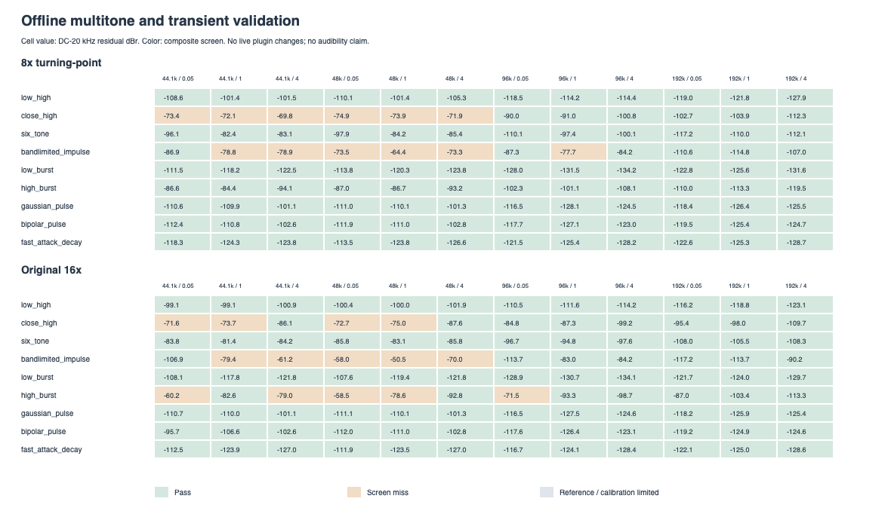
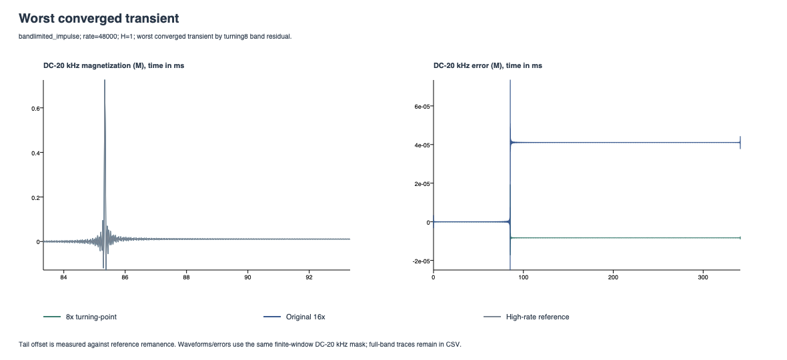
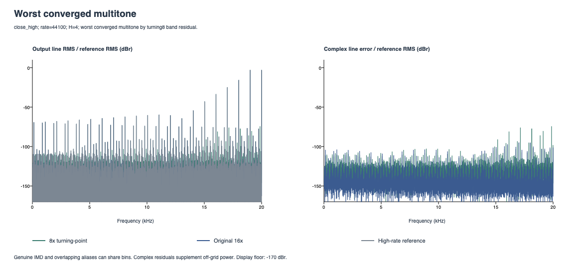

# Offline magnetic multitone and transient validation

8x passes **96/108** composite screens; original 16x passes **94/108**. **0** stimuli have unresolved audio-band references.

The live plugin and favorite tanh voicing remain unchanged. These normalized H-to-M experiments evaluate the existing kernels; no candidate was retuned to pass the grid.

The 8x candidate remains offline. Its aggregate advantage does not establish a universal replacement for 16x; the quality-screen misses below remain work to resolve.

## Results

| Signal | Method | Pass / 12 | Worst band residual dBr | Worst off-grid dBr | Max absolute band peak error dB | Worst tail mean error dBr |
|---|---|---:|---:|---:|---:|---:|
| low_high | 8x turning-point | 12/12 | -101.35 | -101.59 | 0.000032 | n/a |
| low_high | Original 16x | 12/12 | -99.12 | -101.85 | 0.000100 | n/a |
| close_high | 8x turning-point | 6/12 | -69.84 | -69.90 | 0.003700 | n/a |
| close_high | Original 16x | 8/12 | -71.60 | -75.51 | 0.001536 | n/a |
| six_tone | 8x turning-point | 12/12 | -82.36 | -83.27 | 0.000374 | n/a |
| six_tone | Original 16x | 12/12 | -81.35 | -84.05 | 0.000423 | n/a |
| bandlimited_impulse | 8x turning-point | 6/12 | -64.38 | n/a | 0.000257 | n/a |
| bandlimited_impulse | Original 16x | 7/12 | -50.51 | n/a | 0.000176 | n/a |
| low_burst | 8x turning-point | 12/12 | -111.49 | n/a | 0.000010 | -136.77 |
| low_burst | Original 16x | 12/12 | -107.64 | n/a | 0.000009 | -130.95 |
| high_burst | 8x turning-point | 12/12 | -84.44 | n/a | 0.000166 | -123.51 |
| high_burst | Original 16x | 7/12 | -58.51 | n/a | 0.000481 | -87.63 |
| gaussian_pulse | 8x turning-point | 12/12 | -101.12 | n/a | 0.000008 | -124.37 |
| gaussian_pulse | Original 16x | 12/12 | -101.13 | n/a | 0.000009 | -124.36 |
| bipolar_pulse | 8x turning-point | 12/12 | -102.56 | n/a | 0.000009 | -124.36 |
| bipolar_pulse | Original 16x | 12/12 | -95.69 | n/a | 0.000018 | -118.98 |
| fast_attack_decay | 8x turning-point | 12/12 | -113.48 | n/a | 0.000010 | -136.31 |
| fast_attack_decay | Original 16x | 12/12 | -111.91 | n/a | 0.000010 | -134.28 |

Pass requires a converged reference; identity errors <= -95 dBr; band residual <= -80 dBr; applicable off-grid power <= -80 dBr; absolute audio-band peak error <= 0.1 dB; applicable tail error <= -80 dBr and drift <= -100 dBr. These are provisional engineering screens, not audibility standards. Missing metrics are inapplicable, never implied passes.

## What the results support

- The 8x candidate has a lower band residual than original 16x in 80/108 converged stimuli. This compares errors against the high-rate reference, not one candidate against the other.
- Multitone off-grid power excludes genuine intermodulation on the three-bin lattice. Complex residuals and selected product-line errors also expose differences that land on that lattice.
- Transient mean-tail error compares retained magnetization with the reference. A nonzero tail is legitimate for this magnetic model; late drift is checked separately.
- Input reconstruction, FIR response, aliasing and history errors all contribute to residuals. The transient residual is not a pure alias measurement.

### Screen misses by reason

| Reason | 8x turning-point | Original 16x |
|---|---:|---:|
| reference unresolved | 0 | 0 |
| identity calibration limited | 0 | 0 |
| band residual | 12 | 14 |
| off-grid power | 6 | 4 |
| audio-band peak error | 0 | 0 |
| tail mean error | 0 | 0 |
| tail drift | 0 | 0 |

Reasons can overlap within a case. Unresolved references or identity calibration limits are separated from quality misses.

## 8x screen misses

| Signal | Base rate Hz | Nominal H scale | Band residual dBr | Off-grid dBr | Reason |
|---|---:|---:|---:|---:|---|
| close_high | 44100 | 0.05 | -73.39 | -74.29 | band residual, off-grid power |
| close_high | 44100 | 1 | -72.14 | -74.94 | band residual, off-grid power |
| close_high | 44100 | 4 | -69.84 | -69.90 | band residual, off-grid power |
| bandlimited_impulse | 44100 | 1 | -78.79 | n/a | band residual |
| bandlimited_impulse | 44100 | 4 | -78.93 | n/a | band residual |
| close_high | 48000 | 0.05 | -74.91 | -75.68 | band residual, off-grid power |
| close_high | 48000 | 1 | -73.93 | -76.33 | band residual, off-grid power |
| close_high | 48000 | 4 | -71.89 | -71.94 | band residual, off-grid power |
| bandlimited_impulse | 48000 | 0.05 | -73.51 | n/a | band residual |
| bandlimited_impulse | 48000 | 1 | -64.38 | n/a | band residual |
| bandlimited_impulse | 48000 | 4 | -73.25 | n/a | band residual |
| bandlimited_impulse | 96000 | 1 | -77.65 | n/a | band residual |

## Reference and calibration

- Final reference factors: {64: 82, 128: 14, 256: 10, 512: 2}. Raw convergence steps are in convergence.csv.
- Worst converged reference band disagreement: -100.59 dBr.
- Worst reference identity error versus analytic input: -102.78 dBr.
- Worst candidate identity error versus reference: 8x -103.39 dBr; 16x -103.52 dBr.
- Full-band reference agreement at the chosen comparison step: 80/108. Near-Nyquist transition-region differences remain in the raw diagnostics; audio-band convergence does not certify full-Nyquist accuracy.
- Reference input is evaluated analytically at the internal rate. The original core and real FIR decimation are checked at 32x/64x, then up to 1024x when necessary. No fitted gain, fitted delay or DC removal is used.

## Diagnostic plots

Each plot selects the worst converged case by 8x band residual. Displayed waveforms and peak errors use DC–20 kHz; full-band diagnostics remain in the CSVs.

## Scope and raw data

This grid evaluates nine signals at 44.1/48/96/192 kHz and nominal field scales 0.05/1/4. It does not establish performance on all music, physical transformer voltages, circuit coupling or measured hardware. The earlier CPU comparison is unchanged and was not rerun here.

[Method and reproduction](../../MagneticMultitoneTransientValidation.md). Raw files: [comparisons](comparison.csv), [stimuli](stimuli.csv), [convergence](convergence.csv), [IMD lines](intermodulation.csv), [transient trace](worst_transient.csv), [multitone spectrum](worst_multitone.csv), [provenance](manifest.json).
