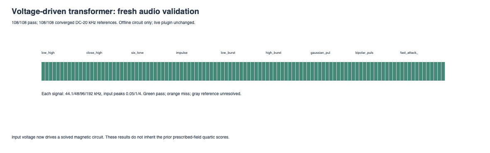
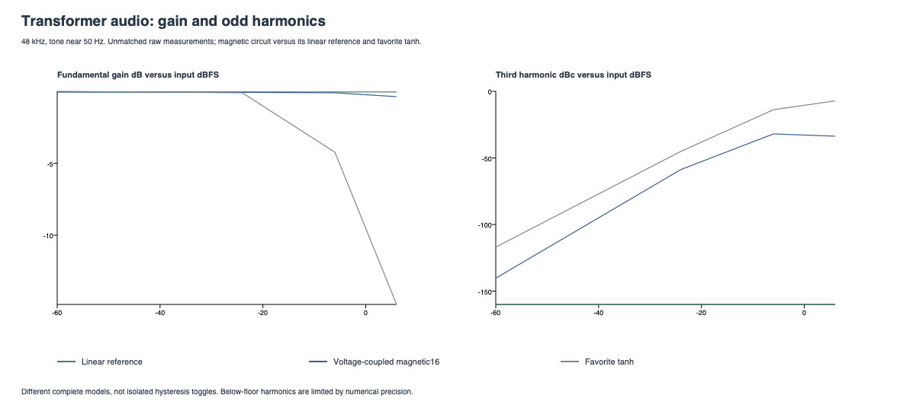
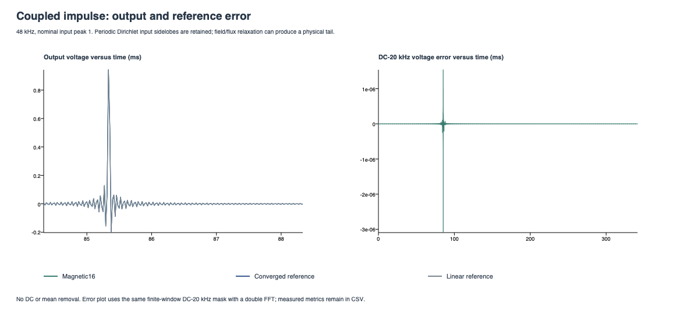

# Offline transformer audio prototype v1

**108/108 numerical comparison screens pass; 108/108 DC-20 kHz references converge.**

A new normalized voltage-driven circuit couples the existing play/Preisach constitutive law to audio. It is linked only into Tests. The live plugin, saved favorite, controls, editor and meters are unchanged.

The coupled circuit uses 16x FIR oversampling and an implicit trapezoidal solve. It does not reuse the standalone quartic field reconstruction inside feedback: that kernel requires future field samples, while this circuit must solve the field. These are fresh end-to-end measurements, not inherited H-to-M scores.

| Signal | Pass / cases | Worst band residual dBr | Worst off-grid dBr | Worst linear calibration dBr |
|---|---:|---:|---:|---:|
| low_high | 12/12 | -119.40 | -139.69 | -119.38 |
| close_high | 12/12 | -104.11 | -140.18 | -104.16 |
| six_tone | 12/12 | -112.13 | -139.71 | -112.12 |
| bandlimited_impulse | 12/12 | -108.34 | n/a | -108.72 |
| low_burst | 12/12 | -118.99 | n/a | -118.99 |
| high_burst | 12/12 | -109.05 | n/a | -109.16 |
| gaussian_pulse | 12/12 | -120.10 | n/a | -120.11 |
| bipolar_pulse | 12/12 | -120.07 | n/a | -120.08 |
| fast_attack_decay | 12/12 | -121.04 | n/a | -121.05 |

## What this establishes

The default coupled model's worst DC-20 kHz residual is -104.11 dBr against the -80 dBr engineering screen. The same grid's worst linear calibration error is -104.16 dBr, so the smallest residuals should be read with that reconstruction/numerical floor in mind. These are default-setting results, not a guarantee for all tunings or audio.

**Keep this implementation offline.** Stereo processing consumes 86.0% of one core's audio-time budget at 48 kHz, 169.9% at 96 kHz and 334.2% at 192 kHz in the stated local benchmark. The solver provides a working reference and listening prototype; optimization is required before live integration.

The first listening comparison is about model behavior, not matching the favorite tanh tone. The circuit has its own low-frequency response and magnetic history; no attempt has been made to force its harmonics onto the favorite preset.

## Model and calibration

The simplified circuit represents finite source/winding resistance, a nonlinear magnetizing branch, and ideal normalized 1:1 transformer coupling with a resistive referred load absorbed into constants. Fixed insertion loss is normalized out. It omits leakage inductance, winding capacitance, eddy-current dynamics and geometry/electrical calibration. It is not a VTB1148 model or a fit to a named transformer.

`B = H + k*M`, `D*x = H + tau*dB/dt`, `y = x - H/D`. Thus output is induced voltage, not M. Quiet input uses a controlled 5 Hz high-pass response; high-frequency small-signal gain approaches unity. Remanence may persist with zero output voltage. No extra DC blocker or DC subtraction hides it.

Defaults: D = 40 times the drive calibration gain, k = 4, memory = 0.35, width = 1; the initial differential flux slope sets tau to give a 5 Hz small-signal pole. All new tuning and solver bounds are centralized in source/experimental/TransformerAudioSettings.h. Drive, corner and magnetic weighting are private prototype settings, not host parameters.

The canonical constitutive law still limits its H input to +/-32. The circuit retains its linear H contribution outside that range while the M contribution saturates; this is an explicit numerical extension, not identified hardware behavior. Input is limited to +/-16 for safety; nonfinite samples become zero excitation without clearing history. Inputs above that safety range are not measurement targets.

## Numerical method

Trial queries read the prior play states without modifying them. A monotone scalar equation is solved with safeguarded Newton steps and a fixed bisection fallback, capped at 48 evaluations. Only the accepted field commits the canonical history. The equation residual is divided by max(1,abs(H)); the threshold is 1e-13. Diagnostics record failures and the worst iteration/residual values.

The 108-case full grid reuses the prior nine waveform shapes at 44.1/48/96/192 kHz and nominal linear input peak bounds 0.05/1/4 (about -26/0/+12 dBFS). The input_peak_linear column records that configured scale; actual sampled peaks depend on waveform and timing. They now drive voltage x, not prescribed H. The Dirichlet impulse includes periodic sidelobes and prehistory. Each render starts demagnetized, warms for one second, then captures 16,384 samples and flushes the filters.

Reference voltage is evaluated analytically at 32x then 64x, extended through 128x/256x/512x if necessary; every reference solves the same circuit at that rate and uses real FIR decimation. Reference input interpolation is independent of the candidate. Convergence requires DC-20 kHz residual <= -100 dBr, band maximum error <= 1e-4 and applicable tail mean error <= -100 dBr. The final convergence step is in comparison.csv and every attempt in convergence.csv.

FIR delays are removed with the previously tested 257-tap fractional alignment filter. Circuit phase remains intact. Linear-circuit candidate/reference renders calibrate combined input reconstruction, integration and alignment (goal <= -95 dBr). The linear time-domain circuit is independently tested against its exact bilinear high-pass transfer function.

Candidate screens: converged reference, calibration <= -95 dBr, band residual <= -80 dBr, applicable off-grid power <= -80 dBr, absolute band peak error <= 0.1 dB, applicable tail mean error <= -80 dBr, and zero solver failures. The output can physically decay while stored flux relaxes; output tail drift is diagnostic, not required to be zero as in the standalone constitutive test. Full-band residual and separate full-band agreement remain diagnostics. No full-Nyquist or arbitrary-signal alias-elimination claim follows.

## Tone measurements

Seven nominal frequencies (20/50/60/200/1k/5k/8k Hz), four input peaks (-60/-24/-6/+6 dBFS), and three models. Actual tones are coherent odd FFT bins and are exported. H2/H3/H5/H7 are relative to the fundamental; harmonics at/above Nyquist are blank. Measurements have no RMS matching. The favorite tanh stage uses Amount 100%, calibration -6.1 dB, emphasis +6.1 dB and corner 103 Hz, with its live implementation unchanged.

| Nominal frequency Hz | Magnetic gain at -60 dBFS | Linear gain at -60 dBFS |
|---:|---:|---:|
| 20 | -0.25080 | -0.25079 |
| 50 | -0.04357 | -0.04357 |
| 60 | -0.02861 | -0.02861 |
| 200 | -0.00266 | -0.00266 |
| 1000 | -0.00013 | -0.00013 |
| 5000 | -0.00004 | -0.00004 |
| 8000 | -0.00002 | -0.00002 |

## Listening fixtures

Three synthetic stereo fixtures (bass phrase, percussion and low/high tones), 48 kHz / 32-bit float / six seconds, including silence before the signal and a two-second decay tail. These are generated test material, not recordings of instruments, voices or hardware. No user recordings were supplied. Each source has linear-reference, magnetic16 and favorite-tanh renders, in raw and whole-file linked-RMS-matched versions. FIR latency is compensated, physical phase remains, and matching gains/peaks are exported. RMS matching is an audition aid, not perceptual loudness normalization.

Comparing magnetic16 with the live favorite changes the complete transformer model, linear response and antialiasing method; it does not isolate hysteresis alone. Use the matched linear reference to assess the magnetic contribution in the same coupling chain. No waveform limiting or DC removal is applied to listening output.

| Fixture | Source | Linear matched | Magnetic matched | Favorite tanh matched |
|---|---|---|---|---|
| synthetic_bass | [WAV](synthetic_bass_source.wav) | [WAV](synthetic_bass_linear_matched.wav) | [WAV](synthetic_bass_magnetic16_matched.wav) | [WAV](synthetic_bass_tanh_favorite_matched.wav) |
| synthetic_percussion | [WAV](synthetic_percussion_source.wav) | [WAV](synthetic_percussion_linear_matched.wav) | [WAV](synthetic_percussion_magnetic16_matched.wav) | [WAV](synthetic_percussion_tanh_favorite_matched.wav) |
| synthetic_low_high | [WAV](synthetic_low_high_source.wav) | [WAV](synthetic_low_high_linear_matched.wav) | [WAV](synthetic_low_high_magnetic16_matched.wav) | [WAV](synthetic_low_high_tanh_favorite_matched.wav) |

## Release CPU and latency

Median of five 16,384-frame mono/stereo runs on this Mac; includes 16x FIR, circuit, copies and stimulus generation, excludes prepare/FFT/file output. A frame contains every channel. The budget percentage is elapsed processing time / audio duration on one core. The timing CSV solver_failures column is channel-0 diagnostics; elapsed timing covers all channels. This is not a worst-case deadline guarantee; it covers the stated test signal only.

| Rate Hz | Channels | ns / base frame | us / 256 frames | Audio-time budget % |
|---:|---:|---:|---:|---:|
| 44100 | 1 | 8903.9 | 2279.4 | 39.3 |
| 44100 | 2 | 17948.7 | 4594.9 | 79.2 |
| 48000 | 1 | 8889.9 | 2275.8 | 42.7 |
| 48000 | 2 | 17919.8 | 4587.5 | 86.0 |
| 96000 | 1 | 8778.6 | 2247.3 | 84.3 |
| 96000 | 2 | 17697.8 | 4530.6 | 169.9 |
| 192000 | 1 | 8631.4 | 2209.7 | 165.7 |
| 192000 | 2 | 17405.9 | 4455.9 | 334.2 |

The offline FIR chain delay is 141.875000 base samples; it is removed from comparisons/listening files. This prototype adds no live plugin latency.

## Impulse behavior

## Outcomes and limits

Worst scaled solver residual: 1e-13; largest solver iteration count: 5. Full-band reference agreement at the chosen convergence step holds in 108/108 cases; that is separate from DC-20 kHz convergence.

The tests cover non-mutating trial queries versus the original core, committed-state circuit equations, analytic linear gain/phase, small-signal response, DC rejection with retained remanence, parameter/input extremes, mono/stereo isolation, reset and block sizes 1 through 4096. Existing plugin/audio regressions also apply.

No numerical reference agreement proves a hardware fit or a preferred sound. Source/load values, winding geometry, realistic high-frequency parasitics, hardware calibration and listening-led tuning remain work. Solver performance and model behavior need evaluation beyond this default setting before live integration.

Data: [comparisons](comparison.csv), [convergence](convergence.csv), [tones](tones.csv), [listening gains](listening.csv), [CPU](timing.csv), [impulse trace](impulse.csv), [provenance](manifest.json). Model derivation, primary references and reproduction commands: [TransformerAudioPrototype.md](../../TransformerAudioPrototype.md).
