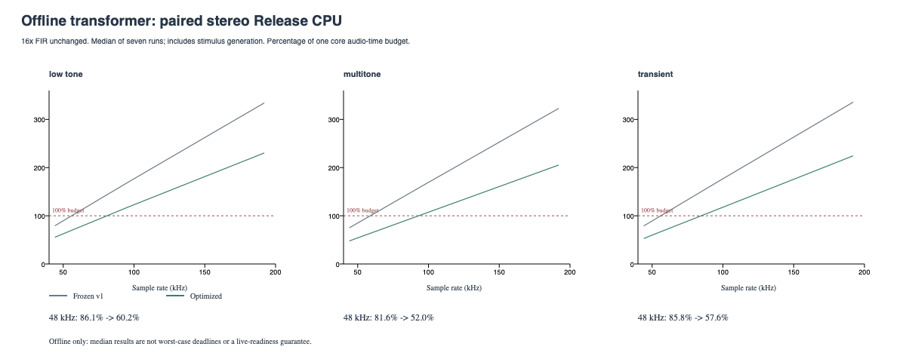

# Offline transformer CPU optimization v1

The Tests-only prototype is **1.43-1.58x faster** across 24 paired Release workload/rate/channel cases (about 30-37% less elapsed work). The original stereo 48 kHz workload drops from **86.1% to 60.2%** of one core's audio-time budget. The model, 16x FIR and 1e-13 tolerance are unchanged; the live plugin is unchanged.

The fresh complete-chain grid passes **108/108** screens with **108/108** converged 64x references. Worst DC-20 kHz residual remains **-104.107709707692 dBr**; maximum scaled equation residual is **9.999998336674936e-14**; maximum observed iterations is five; failures are zero. FIR latency remains 141.875 base samples, with no live plugin latency change.

All five measurement CSVs and all **21 regenerated WAV files are byte-identical** to the preserved v1 files. The normal frozen-reference test also checks every raw double sample in 108 stereo waveform/rate/level windows, plus extreme settings, branch queries, reset/reprepare and linear paths. The old [listening files](../transformer_audio_v1/README.md#listening-fixtures) remain the current examples; no duplicate WAV set is stored here. See [byte comparisons](equivalence.json).

The optimization caches exact nonlinear values for unchanged coordinates, reuses the accepted-field trial and avoids a second nonlinear evaluation during the accepted-state commit. It preserves the original canonical summation order. All storage remains fixed, with no allocation, locks or logging in processing.

## Timing interpretation

[Paired timings](paired_timing.csv) contain medians of seven 16,384-frame runs, alternating old/new order after warming both. Workloads: low tones, multitone, repeated transients; mono/stereo at 44.1/48/96/192 kHz. Timing includes 16x FIR, circuit, copies and stimulus generation; preparation/FFT/file output are excluded. A frame includes all channels. Failure counts aggregate both implementations and all active channels. Every checksum is identical and all those failure counts are zero. Runs did not overlap builds or other tests.

The separate [export timing](export_timing.csv) repeats the original five-run low-tone method after the full export. Its failure column covers channel 0, as before. Use the paired data for before/after comparisons. The [sampling summary](profile_summary.txt) identifies the original constitutive tanh calls as the main circuit cost; FIR cost is outside that standalone profile.

## Limits and next work

This remains offline: the paired low-tone stereo cost is 118.3% at 96 kHz and 230.4% at 192 kHz. These are local medians for stated signals, not worst-case deadline guarantees or hardware measurements. No hardware fit or subjective improvement is claimed.

Broader extreme-setting tests also expose inherited 48-iteration-cap misses in the original solver. The optimized solver preserves output, magnetic history, residuals and failure counts exactly. Those cases are documented in the [method and limits](../../TransformerAudioCpuOptimization.md#independent-reference-and-checks); the default validation grid has zero failures. A separate robustness pass should precede live use.

Raw data: [comparison grid](comparison.csv), [reference convergence](convergence.csv), [impulse](impulse.csv), [tones](tones.csv), [listening gains](listening.csv), [provenance](manifest.json). See [implementation and reproduction](../../TransformerAudioCpuOptimization.md).

## Builds and tests

Debug VST3/AU/Standalone/Tests and Release Tests build with zero warnings/errors. All 126 functional cases pass in Debug (282,070 assertions) and Release with the full export (283,277 assertions). The separate paired CPU export passes 50 assertions. Benchmarks is not built; the generated unbuilt placeholder is excluded from the final CTest commands.

All 41 live source files, the saved favorite, the canonical core implementation and all 38 original measurement artifacts are unchanged. The core header adds only a private friendship for the cached commit. No experimental circuit/reference symbols are present in any of the three plugin binaries.
